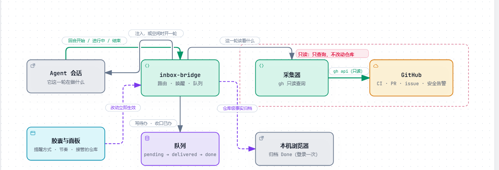

# GitHub inbox

[](https://github.com/c3115644151/dsh-inbox-bridge/actions/workflows/ci.yml)
[](https://www.npmjs.com/package/dsh-inbox-bridge)
[](LICENSE)
[](https://c3115644151.github.io/dsh-inbox-bridge/index.json)

English | [中文](README.md)

`dsh-inbox-bridge` is a DSH plugin that gives each session its own GitHub notifier. It watches **what this session did on GitHub and whether that came back**: your pull request failed its checks, received a review, the issue assigned to you moved, a comment mentioned you. What it finds becomes one notice at the session that should act on it — and when the session is idle and the fact matters, it opens a turn itself.

It does not track "what is in the GitHub account". It tracks "did what my agent did get an answer", so it is decoupled from the account: several sessions on one account each receive their own.

<p align="center">
  
</p>

## Why it exists

When an agent writes the code, the repository does not move in step with the conversation. A CI run takes minutes to half an hour; meanwhile the agent is editing something else and does not see the failure happen. A review arrives, an issue gets answered, and nobody picks it up. By the time anyone looks, the cheapest moment to fix it has passed.

This plugin hands that loop to the agent: once per turn it reads the sources and puts the facts that need this session into the context. Product work and repository upkeep stop interrupting each other, and the agent keeps the repository in shape the way a maintainer does instead of waiting for you to check.

That is also why it only reads: its job is to make the agent aware. The work happens in the agent's own turn — the one you are in, or the one it was given — not in the background behind your back.

## What it does

- **Relevance comes from your identity.** It queries as your `gh` login (or a configured App identity) and keeps only facts where you are the author, the reviewer, the assignee, or are mentioned. Someone else's red PR, and unrelated repositories, never enter the queue.
- **Your own work follows you.** Beyond the current repository it searches everything the account can read: pull requests you opened elsewhere, issues assigned to you, comments that mention you — the answer reaches the session that is working. The key carries a digest of the item's state (open/merged/closed plus the comment count), so "somebody answered you" is news again; the first look is only a baseline and never replays years of closed pull requests.
- **Take a repository over, and its own facts are yours.** The first session in a workspace takes over the repository it sits in; only then do repository-level facts (default-branch CI, security advisories) reach that session. Taking over and releasing are both manual, and one repository may have several owners.
- **Two tiers of ownership.** Repository-level facts go to the owners; item-level facts (one pull request, one issue) go to the sessions working in that repository. When both would match, one fact still wakes one session.
- **Polling follows turns.** Once when a session starts, every minute while a turn runs, once when it ends; an idle session makes no request. Only with `delivery: wakeup` does it also read on that interval while idle — without that it could never wake you while you are away.
- **It also watches security and merge state.** Open Dependabot and code-scanning alerts, and a pull request of yours that conflicts with the base branch or is behind it, matter as much as a red check.
- **The run that happens at night counts too.** A scheduled workflow that fails says it was scheduled, instead of reading as the last push failing; a review comment on your own pull request is reported as itself, and a push that answers it closes it.
- **It tidies what it read, without a switch.** Repository-level facts (CI, advisories) are archived by the owner; item-level facts (answers on a pull request or issue) are only marked read — whoever received them clears them, and nobody touches another session's ledger.
- **It goes into the context, and opens a turn only when it has to.** By default a notice arrives at the next safe injection point and does not interrupt the tool loop; with `delivery: wakeup` it opens a turn only for a listed `wakeOn` role, after the session has been idle for 15 minutes, at most 3 times in a row per session, and at most 2 times an hour — anything else keeps queueing. A notice is marked `delivered`, and unhandled events come back once after six hours.
- **The session decides how to handle a fact.** "Handling" has two modes: act now (the default — act as soon as it arrives) and confirm first (finish the current task, then report the collected facts together and wait for your call). It changes neither delivery nor whether a turn opens — that is delivery's job.

## What you will see

At the top of a turn, one line per fact and nothing else:

> 【告知】 2 条 · 后台派发，不是用户提问
> - [请你评审] example-org/example-repo#23 fix: retry on flaky upload https://github.com/…
> - [CI 失败] example-org/example-repo chore: release 2.3.1 https://github.com/…

The bracket is what it asks of you; then the repository and number, the title, the link. Others you may see: `CI 恢复`, `定时任务失败`, `指派给你的 issue`, `有人 @ 你`, `你的 PR 有新评审`, `你的 PR 有冲突`, `依赖告警`, `代码告警`.

**The notice carries no plugin mechanics**: no credential line, no poll cadence, no wakeup rules, no ack command — those live in configuration and documentation, and in a context window they are only cost. For the queue or a manual close: `inbox-bridge.mjs list` / `ack --done -- <key>`.

## How it works

<p align="center">
  
</p>

Three boundaries: **GitHub is read-only** (queried as your identity, never changed); **the plugin only knows and decides when to speak**; **the work happens in the session's own turn**. Polling follows turns, facts are routed by tier, and only the session that owns one is woken.

## The panel

The status row under the composer carries a chip: when something is waiting, a blue dot appears on the icon and the count follows. Hovering it opens a panel with:

- the events: role, repository, title (link), time;
- the identity and the last poll;
- two controls: delivery (queue only / may wake — selecting "may wake" reveals a `⌄` on the button that opens the rhythm rows) and how the session handles its facts (act now / confirm first), plus the repositories this session took over (paste a repository link or type `owner/name`; `×` releases).

Each control explains itself on hover. Changes apply immediately and are stored in `<cwd>/.work/inbox-bridge/prefs.json`; they do not rewrite the DSH plugin configuration, and a reset returns to the configured values. The panel is per session: switching sessions shows what that session took over and what would reach it.

## Install

You need DSH and a `gh` that is already logged in on this machine (`gh auth status` should pass). Windows, macOS and Linux are supported.

**From the plugin market** (DSH's Plugins → Discover): add an index source with the address

```text
https://c3115644151.github.io/dsh-inbox-bridge/index.json
```

GitHub inbox shows up in the list; install it and it works.

**From source:**

```powershell
git clone https://github.com/c3115644151/dsh-inbox-bridge
dsh plugin add ./dsh-inbox-bridge
```

**From npm** (the profile needs to run pnpm):

```powershell
dsh plugin add dsh-inbox-bridge
```

All three install the same package; the version is on [npm](https://www.npmjs.com/package/dsh-inbox-bridge).

After installing, set the working directory `cwd` in the plugin configuration. The repository and the identity are read from that directory's `git remote` and from `gh`; there is nothing else to fill in.

To see what it can actually see: `node scripts/inbox-bridge.mjs doctor` checks the identity, repository access, the last poll and the queue; when something did not reach you, `node scripts/inbox-bridge.mjs explain <key>` shows where it stopped.

## Settings

| Key | Default | Meaning |
| --- | --- | --- |
| `cwd` | DSH process directory | Where state lives; the starting point for inferring repositories |
| `repo` / `repos` | `[]` | Instance-level ownership: these `owner/name` are watched no matter which session. Usually empty — session ownership joins in automatically |
| `delivery` | `quiet` | `quiet` only delivers at the next step; `wakeup` may also open a turn when the session is idle (otherwise the notice is delivered as usual) |
| `wakeOn` | empty | Role whitelist for waking under `wakeup`; empty means it never wakes |
| `clear` | `repo` | Mark the threads it read as read: `repo` / `all` / `off`. Never touches what it did not read |
| `sweep` | on | Archive repository-level facts (CI, advisories) into Done; a missing sign-in opens a window instead of asking you to type |

Full settings, command line and state files: [settings and commands](docs/configuration.md).

## Boundaries

- **Read-only.** It does not merge, comment, or change a repository.
- **It does not open a conversation by default.** Only with `delivery: wakeup`, a matching `wakeOn` role, a long enough idle window, and budget left; any gate that fails falls back to queueing.
- **One fact wakes one session.** It does not arbitrate concurrent work: one pull request never wakes two sessions, but two agents already acting on it are beyond it.
- **Archiving needs one browser sign-in, and you are not asked to run anything.** GitHub has no archive API, so `scripts/clear-inbox.mjs` uses the local browser (Edge / Chrome / Chromium); when the sign-in is missing the plugin opens the window itself, and opens it again when the session expires.
- **Archiving only touches repository-level facts.** It walks the repositories you took over through GitHub's notification search view (`repo:owner/name`) and archives only runs, advisories and releases; answers on pull requests and issues are only marked read. The whole inbox needs an explicit `--all`.
- **State is local.** It lives under the workspace's `.work/` and is not synced across machines.

## More

- Ownership rules, polling, state machine and known limits: [how it works](docs/how-it-works.md)
- Every setting, the command line, identity and roles: [settings and commands](docs/configuration.md)
- Version history: [CHANGELOG.md](CHANGELOG.md)
- What comes next: [ROADMAP.md](ROADMAP.md)
- Contributing: [CONTRIBUTING.md](CONTRIBUTING.md)