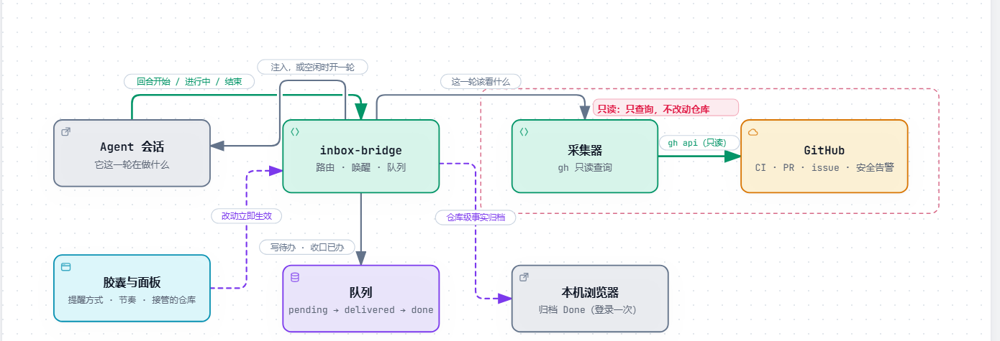

# GitHub inbox

[](https://github.com/c3115644151/dsh-inbox-bridge/actions/workflows/ci.yml)
[](https://www.npmjs.com/package/dsh-inbox-bridge)
[](LICENSE)
[](https://c3115644151.github.io/dsh-inbox-bridge/index.json)

[English](README.en.md) | 中文

`dsh-inbox-bridge` 是一个 DSH 插件，给每个会话配一个自己的 GitHub 通知器：它盯着**你这个会话在 GitHub 上的动作有没有得到回应**——自己开的 PR 挂了 CI、收到了评审意见，指派的 issue 有了动静，评论里有人 @ 你——把结果汇成一条消息送到该会话面前。会话空闲又遇到要紧的事，它还能主动开一轮，让 agent 自己去修、去审、去接。

它不管「GitHub 账号上有什么消息」，只管「我这个 agent 做的事有没有回音」。所以它和账号解耦：同一个账号下的多个会话各自收各自的事。

<p align="center">
  
</p>

## 为什么需要它

用 agent 写代码，仓库里的工作并不跟着对话走。一次 CI 要跑几分钟到几十分钟，这期间 agent 已经在改别的东西，失败发生时它看不见；评审意见来了、issue 有人接了，同样没人处理。等想起来去翻，往往已经过了最该动手的时候。

它的意图是把这件事交给 agent 自己：每轮取一次数，把「你做的事现在需要你」的事实带进上下文。开发本身和仓库维护不再互相打断，agent 像维护者一样把仓库维持在健康状态，而不是等你回来看。

这也是它只读的原因：它负责让 agent 知道该做什么；动手的是 agent 自己那一轮——可能是你正在开的，也可能是它替你开的——而不是在后台背着你改仓库。

## 它做什么

- **按身份判断相关性。** 用 `gh` 的登录身份（或配置的 App 身份）查询，只保留以你为作者、评审人、指派对象或提及对象的事实；别人的 PR 失败、无关仓库的变动不会进入队列。这些事实还只在**本机接得住的仓库**排队——没有会话在那里干活、也没人接管那个仓库时，搜索命中只记账不入队，轮询会说明忽略了多少条。
- **我维护的仓库里出现的东西也算我的。** 仓库对我是 owner 或 admin 时，别人开进来的 PR 与 issue 就是维护者该看到的事，不必等他们指派我或 @ 我。别人的仓库不算：那里堆着的 PR 与你无关。
- **自己的事，走到哪跟到哪。** 除了当前仓库，它还会搜索整个账号能读到的范围：你在别的仓库开的 PR、被指派的 issue、被 @ 的评论，回音都送到正在干活的那个会话。key 带一条状态摘要（开着/合并/关闭 + 评论数），所以「有人回了你」会再通知一次；第一次只记基线，不会把历年关掉的 PR 一次倒出来。
- **接管一个仓库，才管整个仓库的事。** 打开工作区的第一个会话自动接管该仓库；接管之后，仓库级的事实（默认分支 CI、安全告警）才归这个会话。接管可以手动加、也可以释放，一个仓库可以有多个接管者。
- **两级归属。** 仓库级事实只给接管者；条目级事实（某个 PR、某个 issue）给在这个仓库里干活的会话。两件事同时命中时，同一条事实只叫一个会话。
- **轮询跟随回合。** 会话开始时一次、进行中每 1 分钟一次、结束时一次，空闲会话不发请求；开启 `delivery: wakeup` 后空闲时也按同一间隔读一次，否则它没机会在你不在时叫醒你。
- **也看安全与合并状态。** 开着的 Dependabot 告警、code scanning 告警，以及我这些 PR 与基分支的冲突或落后，和 CI 失败一样要紧。
- **夜里跑的那次也算。** 定时工作流（`schedule`）失败时标明是定时任务，不与「最后一次推送失败」混在一起；自己的 PR 收到评审意见时把那条意见本身报出来，推了新提交、意见被代码回答之后自然收口。
- **顺手清掉读过的。** 固定行为，没有开关：仓库级的事实（CI、安全告警）由接管者在 GitHub 上归档；条目级的事实（PR、issue 的回复）只标已读——谁收到谁清，不动别人的账。
- **送进上下文，必要时才开一轮。** 默认只在这一轮的下一次安全注入点进入会话，不打断工具循环；开启 `delivery: wakeup` 后，只有命中 `wakeOn` 的角色、会话空闲满 15 分钟、每会话连续不超过 3 次、每小时不超过 2 次时才主动开一轮；其余情况不干等，照常在这一轮的下一个注入点交给你。送达后标为 `delivered`，未处理的 6 小时后重新提醒一次。
- **收到后怎么处理，会话自己定。** 「处理方式」两档：直接处理（默认，收到就动手）和先确认（先做完手头的事，再把攒下的消息一起汇报给你，等你反馈）。它不改变送达，也不决定要不要开新一轮——那由提醒方式说了算。

## 你会看到什么

出现在回合开头，一行一条，只有事实本身：

> 【告知】 2 条 · 后台派发，不是用户提问
> - [请你评审] example-org/example-repo#23 fix: retry on flaky upload https://github.com/…
> - [CI 失败] example-org/example-repo chore: release 2.3.1 https://github.com/…

方括号里是它要你做的那件事，后面依次是仓库与编号、标题、链接。可能出现的还有 `CI 恢复`、`定时任务失败`、`指派给你的 issue`、`有人 @ 你`、`你的 PR 有新评审`、`你的 PR 有冲突`、`依赖告警`、`代码告警`。

**通知里不写插件自己的事**：不报读取用的身份，不报轮询节奏与唤醒规则，也不塞收口命令——那些属于配置和文档，写进上下文只是占地方。需要看队列或手动收口时：`inbox-bridge.mjs list` / `ack --done -- <key>`。

## 它怎么运作

<p align="center">
  
</p>

三个边界：**GitHub 只读**（按身份查，不改动）；**插件只负责知道与何时开口**；**动手发生在会话的那一轮里**。轮询跟着回合走，事件按仓库级/条目级分给会话，只有该负责的那个会被叫起来。交互版见 [architecture.html](docs/assets/architecture.html)。

## 界面

输入框下方的状态行里有一个胶囊：有未处理事件时，图标右上角出现一个蓝点，旁边是数量。鼠标悬停展开面板：

- 事件列表：角色、仓库、标题（可点开）、时间。
- 身份、上次轮询时间。
- 两组开关：提醒方式（仅注入 / 主动唤醒；选中「主动唤醒」后按钮右侧出现 `⌄`，点它展开「节奏」两行）、处理方式（直接处理 / 先确认——每个会话自己选），外加接管的仓库清单（粘贴仓库链接或写 `owner/name` 接管；`×` 释放）。

每个按钮的悬停提示写明了它的作用。改动立即生效，记录在 `<cwd>/.work/inbox-bridge/prefs.json`，不修改 DSH 的插件配置；重置后回到配置里的值。面板按会话取数：切换会话显示该会话接管了什么、会收到什么。

## 安装

需要 DSH，以及一个已在本机登录的 `gh`（`gh auth status` 可验证）。支持 Windows、macOS 与 Linux。

**从插件市场**（DSH 内置「插件 → 发现」）：添加索引源，地址填

```text
https://c3115644151.github.io/dsh-inbox-bridge/index.json
```

列表里会出现 GitHub inbox，安装后即可用。

**从源码：**

```powershell
git clone https://github.com/c3115644151/dsh-inbox-bridge
dsh plugin add ./dsh-inbox-bridge
```

**从 npm**（profile 里能跑 pnpm 即可）：

```powershell
dsh plugin add dsh-inbox-bridge
```

三条路装的是同一个包，版本见 [npm](https://www.npmjs.com/package/dsh-inbox-bridge)。

安装后在插件配置里指定工作目录 `cwd`。仓库名与身份都从该目录的 `git remote` 与 `gh` 读取，不需要另外填写。

想确认它到底能看见什么：`node scripts/inbox-bridge.mjs doctor` 逐项检查身份、仓库可读性、上次轮询与队列；某件事没到眼前，用 `node scripts/inbox-bridge.mjs explain <key>` 看它卡在哪一步。

## 配置

| 键 | 默认 | 作用 |
| --- | --- | --- |
| `cwd` | DSH 进程工作目录 | 状态文件位置；推断仓库的起点 |
| `repo` / `repos` | `[]` | 实例级接管：无论哪个会话都盯这些 `owner/name`。平时不用写——会话接管会自动并进来 |
| `delivery` | `quiet` | `quiet` 只入队；`wakeup` 可在会话空闲时主动开启一轮 |
| `wakeOn` | 空 | `wakeup` 下允许唤醒的角色白名单；为空则永不唤醒 |
| `clear` | `repo` | 把读过的通知标为已读：`repo` / `all` / `off`。只清自己读过的，不动别人的 |
| `sweep` | 开 | 仓库级事实（CI、安全告警）归档到 Done；缺登录时插件自己弹窗口让你登录一次 |

完整配置、命令行与状态文件见 [配置与命令](docs/configuration.md)。

## 边界

- **只读。** 不合并、不评论、不修改仓库。
- **默认不主动开启对话。** 只有显式设置 `delivery: wakeup` 且命中 `wakeOn`、会话足够空闲、两个预算都还有余额时才会；任何一道门不过，就退回「照常交给它、只是不替它开轮」。
- **一件事实只叫一个会话。** 它不仲裁并发行动：同一个 PR 不会同时唤醒两个会话，但已经动手的两个 agent 之间它管不了。
- **Done 归档依赖一次浏览器登录，但不用你敲命令。** GitHub 没有归档 API，`scripts/clear-inbox.mjs` 通过本机浏览器（Edge / Chrome / Chromium）完成；缺登录时插件自己弹窗口，会话失效时会再弹一次。
- **归档只碰仓库级事实。** 它按接管的仓库逐个打开 GitHub 的通知搜索视图（`repo:owner/name`），只归档 CI 运行、安全告警、发布这类线程；PR 与 issue 的回复只标已读。整个收件箱要显式 `--all` 才会动。
- **状态在本机。** 存放在工作目录的 `.work/` 下，不跨机器同步。

## 更多

- 归属规则、轮询时机、状态机与已知限制：[工作原理](docs/how-it-works.md)
- 全部配置项、命令行、身份与角色：[配置与命令](docs/configuration.md)
- 版本变更：[CHANGELOG.md](CHANGELOG.md)
- 后续计划：[ROADMAP.md](ROADMAP.md)
- 参与开发：[CONTRIBUTING.md](CONTRIBUTING.md)